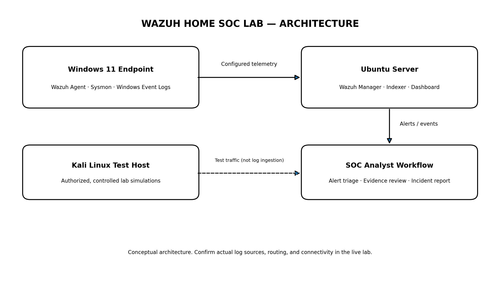

# Wazuh Home SOC Lab

**SOC L1 Portfolio Project | SIEM Monitoring | Windows Telemetry | Detection Testing | Incident Investigation**

  

> **Project status:** Personal learning lab. Historical screenshots are included. The network-scan screenshot visibly shows a Wazuh event labelled `Nmap Scan Detected: Windows Firewall blocked TCP connection from Kali` (rule ID `100100`, level `10`). The SSH brute-force result remains author-reported because an SSH-specific alert screenshot/event is not included. Screenshots are historical snapshots, not a live system view.

## Project overview

This repository documents a home Security Operations Center (SOC) lab built to practice the SOC Level 1 workflow: checking telemetry, reviewing SIEM alerts, validating suspicious activity, correlating logs, assessing false-positive possibilities, and writing investigation notes.

The lab uses Wazuh for centralized security monitoring, Ubuntu Server for the Wazuh stack, a Windows 11 endpoint with the Wazuh Agent and Sysmon, and Kali Linux for authorized security tests against the author's own lab systems.

## Lab environment

| Component | Role | Notes |
|---|---|---|
| Wazuh Manager, Indexer, Dashboard | SIEM and alert review | Lab notes recorded Wazuh `4.14.7`; verify the live version before relying on it |
| Ubuntu Server | Wazuh host | Receives and analyzes endpoint telemetry |
| Windows 11 | Monitored endpoint | Wazuh Agent, Windows Event Logs, Sysmon, PowerShell activity |
| Kali Linux | Test platform | Used only for authorized tests within the personal lab |

This repository is prepared with lab IP addresses omitted from the architecture documentation. Before adding new evidence, redact internal IP addresses, personal usernames, host identifiers, tokens, credentials, and unredacted logs.

## Architecture

See [Architecture and event flow](architecture/architecture.md).

## Scenarios and status

| Scenario | Status | Public evidence |
|---|---|---|
| Windows process monitoring with Sysmon | A Sysmon process-creation event was previously observed; end-to-end Wazuh correlation should be rechecked | Screenshots/log excerpt pending |
| SSH brute-force simulation | **Author-reported tested; alert observed** | Screenshots and sanitized event details pending |
| Network scan | **Alert visible in historical screenshot** | [`04-network-scan-detection-alert.png`](screenshots/04-network-scan-detection-alert.png) — rule ID `100100`, level `10` visible |
| Firewall event detection | Rule/configuration work was recorded; end-to-end matching alert needs re-verification | Evidence pending |

“Author-reported” means the project owner has stated the test worked, but the repository does not yet contain enough evidence for an outside reader to independently confirm it. The included network-scan screenshot supports the specific event shown there; it does not prove the rule is still configured identically today. Dashboard counts are historical and may change.

## What this project demonstrates

- SIEM deployment concepts and agent connectivity checks
- Windows endpoint telemetry using Windows Event Logs and Sysmon
- Alert triage and event correlation
- Controlled SSH authentication-failure and network-scan testing
- Detection validation and recognition of telemetry gaps
- MITRE ATT&CK technique mapping at a high level
- SOC L1 investigation workflow and incident-report writing
- Security documentation, troubleshooting, and evidence handling

## Repository map

- [`architecture/`](architecture/) — architecture diagram and event flow
- [`setup/`](setup/) — Wazuh server, Windows agent, Sysmon, and troubleshooting guides
- [`detections/`](detections/) — test plans and evidence checklists
- [`investigations/`](investigations/) — SSH, network-scan, and process-investigation case templates
- [`rules/`](rules/) — example rule placeholder and validation notes
- [`docs/`](docs/) — SOC workflow, log analysis, MITRE ATT&CK mapping, lessons learned
- [`reports/`](reports/) — incident report template
- [`screenshots/`](screenshots/) — genuine historical lab screenshots, including a network-scan detection event
- [`evidence/`](evidence/) — evidence log guidance

## SOC L1 workflow used

1. **Validate:** confirm the alert timestamp, endpoint, source, rule metadata, and original log.
2. **Triage:** determine whether activity matches the authorized test or could have a benign explanation.
3. **Investigate:** inspect event fields and surrounding events in the same time window.
4. **Correlate:** compare SIEM alerts with the source log where available.
5. **Scope:** identify affected host/account/process/network endpoints only where evidence supports it.
6. **Classify:** mark the finding benign, suspicious, or inconclusive; avoid overclaiming compromise.
7. **Recommend:** suggest monitoring, hardening, or escalation appropriate to the lab.
8. **Document:** preserve timestamps, observed rule details, evidence references, limitations, and next steps.

## Evidence included and still needed

Authentic historical screenshots are included in [`screenshots/`](screenshots/):

- Wazuh dashboard overview and active Windows agent status.
- Threat Hunting dashboard and Windows authentication-failure events.
- A Wazuh event view labelled `Nmap Scan Detected: Windows Firewall blocked TCP connection from Kali` (rule ID `100100`, level `10` visible in the screenshot).
- A Windows Firewall source-log view with IP address columns redacted.

Evidence still needed for stronger independent verification:

1. An SSH-specific brute-force test window and matching SSH alert/event. The included Windows logon-failure screenshot is not represented as SSH evidence.
2. A Sysmon process-creation event paired with the corresponding Wazuh event, if available.
3. A Wazuh custom firewall-rule alert proving end-to-end rule matching.

Screenshots are historical snapshots; current dashboard counts and configuration may differ. For each future detection, record actual date/time and timezone, sanitized source/target, rule ID/level, source log, result, evidence path, and limitations. Do not fabricate screenshots or fill unknown fields with guesses.

## Safety and scope

- Test only systems you own or are explicitly authorized to assess.
- Keep tests low-volume and confined to the personal lab.
- Never commit passwords, API keys, tokens, private keys, or sensitive logs.
- Review screenshots for IP addresses, usernames, browser tabs, and file paths before publishing.
- This is a learning project, not a production SOC or a guarantee of complete detection coverage.

## Author

**Dhruv Vats** — aspiring SOC Analyst / Cybersecurity fresher.

- GitHub: [@dhruvvats17](https://github.com/dhruvvats17)

This portfolio documents practical learning and should not be interpreted as professional experience or a claim of production SOC operations.

## Reports and investigation write-ups

- **[Complete technical report (Markdown)](reports/wazuh-home-soc-lab-technical-report.md)**
- **[Complete technical report (PDF)](reports/wazuh-home-soc-lab-technical-report.pdf)**
- [Network-scan alert investigation](investigations/case-002-network-scan.md)
- [SSH brute-force test notes](investigations/case-001-ssh-bruteforce.md)

The report distinguishes screenshot-supported findings from author-reported test history. Screenshots are historical snapshots; they do not prove current system status.
